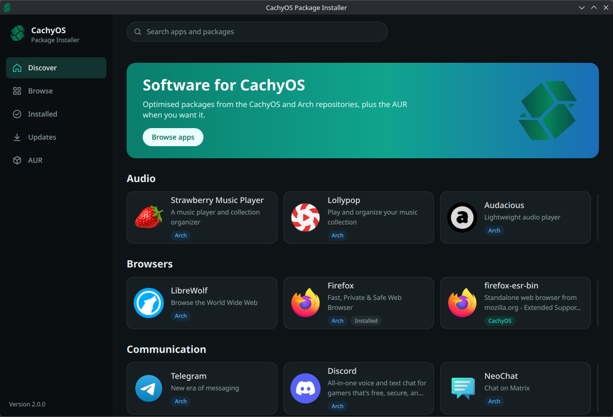
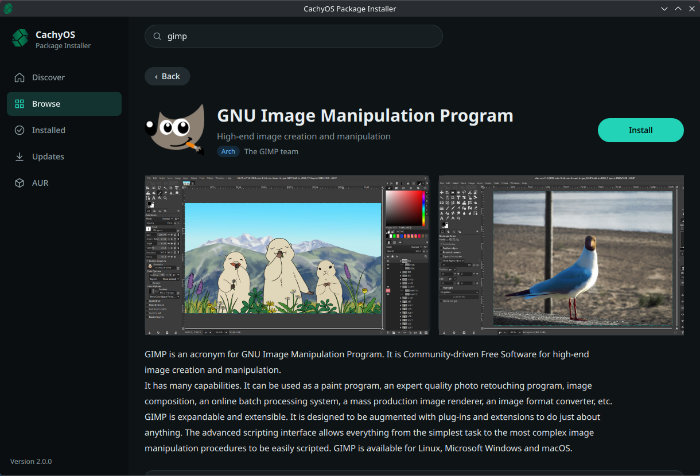
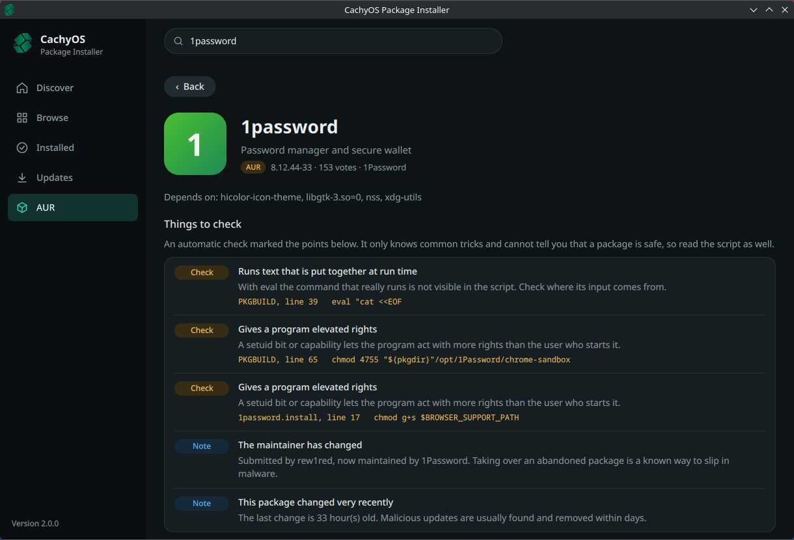
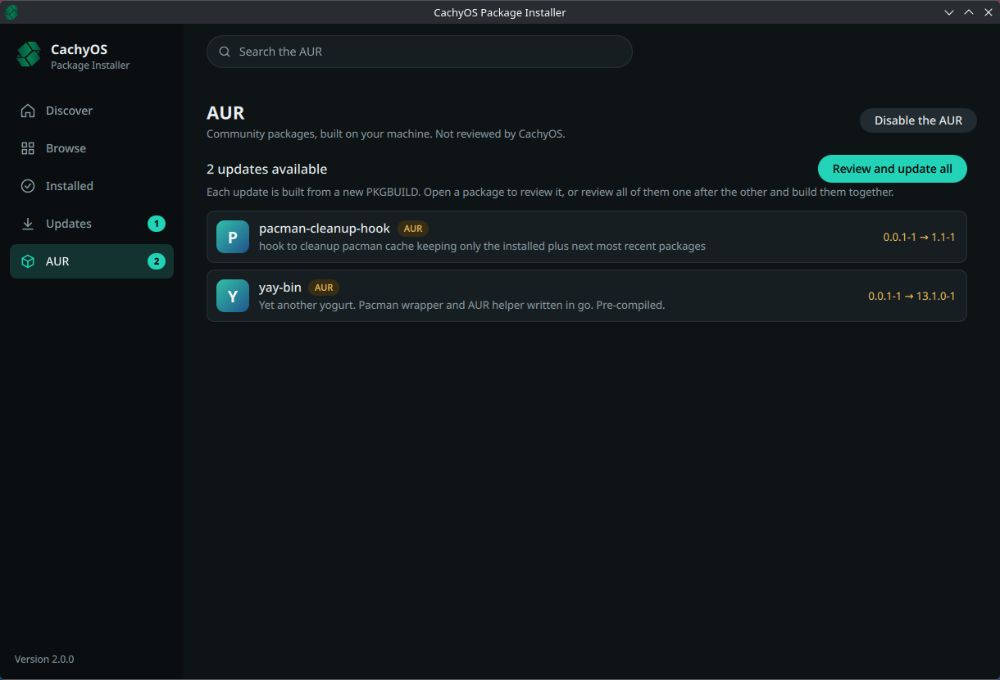

# cachyos-packageinstaller

A small app store for CachyOS: browse, install, remove and update packages from
the CachyOS and Arch repositories, build packages from the AUR, install
Flatpak apps and add AppImage files to the menu.

- **Repositories** are read directly through libalpm; nothing runs as root until
  you confirm an operation.
- **Icons and app metadata** come from the system AppStream catalog
  (`archlinux-appstream-data`, and any other catalog in `/usr/share/swcatalog`).
  Packages without AppStream data fall back to the icon theme and then to a
  generated tile, so every package has an icon.
- **AUR** is opt-in. Search and PKGBUILD review happen in the app; building is
  delegated to `paru`. A package is cloned for the review, and that checkout is
  what gets built, so a later change in the AUR cannot slip in. AUR packages it
  depends on are reviewed in the same way; paru is started so that it cannot
  fetch anything else from the AUR. Once enabled, the AUR page lists the installed AUR
  packages that have a newer version. Each update is reviewed like an install;
  "Review and update all" walks through the reviews and builds the accepted
  packages in one go.
- **Flatpak** is opt-in as well and needs no extra build dependency: the app
  reads the AppStream catalogue Flatpak keeps for its system-wide remotes and
  runs the `flatpak` command to install (system-wide), remove and update apps.
  Flatpak asks for permission itself. The Flatpak page lists the installed apps
  and their updates; remotes other than Flathub are used if they are set up, but
  are not managed here.
- **AppImage** is opt-in too. There is no catalogue: a file you downloaded
  (picked, dropped on the page, or given as `cachyos-pi file.AppImage`) is
  copied to `~/Applications` and gets a menu entry and an icon, all as your
  user. Reading the name and icon runs the file's own extractor, so the page
  asks first. The menu entries carry a mark and are the only record; adding a
  newer file of the same app replaces the old one.
  A file can also be taken from a project on GitHub ("From GitHub…", a link
  like `https://github.com/owner/project`): the AppImage of its newest release
  is downloaded, the menu entry remembers the project, and a newer release is
  shown as an update on the page. GitHub is asked at most every six hours, or
  when "Check for updates" is pressed; nothing is replaced without a click.
  Releases are not signed: the download is only compared with the size and
  checksum GitHub lists for it.
- **PKGBUILD check**: the review page marks lines a reviewer should look at
  (see below). It is a reading aid and never declares a package safe.
- **Appearance**: the settings page switches between colour themes (four of our
  own plus Nord, Dracula, Catppuccin, Tokyo Night and Solarized, credited in
  `THIRD-PARTY.md`) and between light, dark and following the desktop.
- **Privileges**: the GUI runs as the user. Package operations go through
  `cachyos-pi-helper`, a tiny pkexec helper that only accepts
  `install`, `remove` and `upgrade`, plus the three pacman calls paru makes to
  install what it built. paru is started with the helper in place of sudo, so one
  authentication covers a whole AUR build.

## Screenshots

| | |
| --- | --- |
|  |  |
| Start page | Package details |
|  |  |
| PKGBUILD review with the automatic check | Updates for AUR packages |

## Dependencies

Build:
```sh
sudo pacman -S base-devel cmake git ninja qt6-base qt6-declarative qt6-tools appstream-qt pacman elfutils
```

Qt 6.10 or newer and a C++26 compiler (GCC 15+, Clang 20+) are required.

Runtime: `qt6-declarative`, `appstream-qt`, `archlinux-appstream-data`, `polkit`, `elfutils` (if built with libdw),
`kimageformats` (the Arch icon cache is JPEG XL). Optional: `paru` and `git` (AUR review and builds),
`flatpak` (Flatpak apps), `fuse2` (most AppImages need it to start), `pacman-contrib` (`checkupdates`, to see updates without refreshing the system
databases).

## Building

```sh
cmake -S . -B build -G Ninja -DCMAKE_BUILD_TYPE=Release -DCMAKE_INSTALL_PREFIX=/usr
cmake --build build
sudo cmake --install build
```

An uninstalled build can be run as `build/cachyos-pi`; without the installed
helper it runs `build/cachyos-pi-helper` through pkexec's generic prompt.

Run the tests with `ctest --test-dir build`.

## Packaging

`packaging/` holds two PKGBUILDs: `cachyos-packageinstaller` builds a tagged
release, `cachyos-packageinstaller-git` the default branch. The release one
needs its checksum filled in (`updpkgsums`) once the version is tagged.

```sh
cd packaging/cachyos-packageinstaller-git
makepkg -si
```

## PKGBUILD check

`src/pkgscan.*` looks at the PKGBUILD, the install scriptlet and other scripts
shipped with an AUR package, plus the package's AUR record. It only reads text:
nothing from the package is sourced or executed. Findings have three levels:

| Level | Examples |
| --- | --- |
| Dangerous | download piped into a shell, decoded-and-executed text, reverse shells, access to SSH keys or browser data, edits to sudoers |
| Check | downloads without checksum, downloads outside `source=()`, `eval`, `sudo` in a build, writes outside `$pkgdir`, setuid bits, enabled services, orphaned or very new packages, look-alike names |
| Note | unpinned VCS sources, outdated checksum types, commands at the top level, changed maintainer |

The check knows common tricks only. No findings does not mean that a package is
safe, which is why the review checkbox stays for every package.

The same check is available on the command line:

```sh
cachyos-pi-scan path/to/package        # directory with a PKGBUILD
cachyos-pi-scan --json path/to/PKGBUILD
```

It exits with 0 (nothing or notes), 1 (something to check), 2 (dangerous
pattern) or 3 (unreadable). The package record and name checks need the AUR and
the package database, so they are only done in the app.

## Layout

| Path | Contents |
| --- | --- |
| `src/alpmdb.*` | read-only libalpm access |
| `src/catalog.*` | AppStream catalog, merged into the package list |
| `src/iconprovider.*` | `image://pkgicon/<name>` icon lookup |
| `src/packagemodel.*` | list model and search/category filter |
| `src/aurclient.*` | AUR RPC search, details and PKGBUILD download |
| `src/flatpakclient.*` | Flatpak catalogue, installed apps and updates |
| `src/appimageclient.*`, `src/appimagedesktop.*` | AppImage files: add, list, remove; menu entry rewriting |
| `src/appimagesource.*` | AppImages from GitHub releases: links, release answers, which file to take |
| `src/pkgscan.*` | static PKGBUILD and script check |
| `src/scan/` | the `cachyos-pi-scan` command line tool |
| `tests/` | unit tests for the check, the AppImage menu entries and `pkglist.yaml` |
| `src/transaction.*` | plan → confirm → run state machine |
| `src/helper/` | the pkexec helper |
| `qml/` | the user interface |
| `pkglist.yaml` | the curated "CachyOS picks" on the start page |
| `org.cachyos.cachyos-pi.metainfo.xml` | AppStream metadata for software centres |
| `packaging/` | PKGBUILDs |
| `THIRD-PARTY.md` | credits and licence of the community colour palettes |
| `screenshots/` | the pictures in this file |
